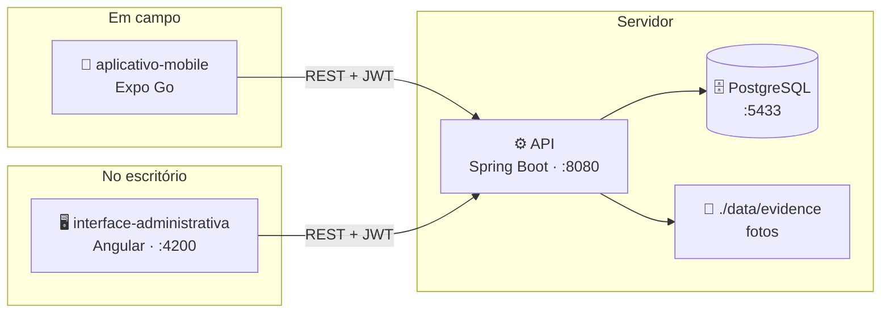
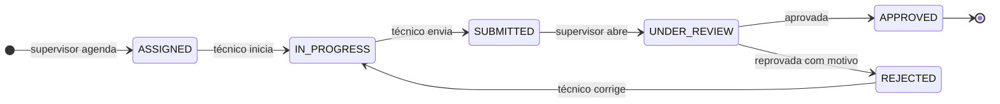

# FieldOps — Interface Administrativa Web

Aplicação Angular (standalone components, sem NgModules) para administração da plataforma FieldOps:
cadastros de clientes/locais/equipamentos, gestão de usuários, construção de modelos de inspeção
(checklists versionados), planejamento e acompanhamento de inspeções, revisão de supervisores,
não conformidades e auditoria.

> **Integração com a API**: os serviços em `src/app/features/*/*.service.ts` foram conferidos e
> ajustados contra a implementação real do `fieldops-api` (endpoints de status via `PATCH .../status`,
> draft de modelos via `GET .../draft`, fluxo de revisão em três etapas `begin-review`/`approve`/
> `reject`, não conformidades e evidências aninhadas em `/inspections/{id}/...`). O contrato completo
> está documentado em `../docs/fieldops-spec.md` (seção 12) e navegável via Swagger UI da API em
> `http://localhost:8080/swagger-ui.html`.

## O projeto FieldOps

Plataforma de **planejamento, execução e revisão de inspeções técnicas em campo**. Um supervisor
planeja a inspeção e monta o checklist na web; o técnico executa no celular, diante do ativo, com ou
sem sinal; o supervisor revisa, aprova ou reprova. Tudo fica auditado.

São três repositórios independentes:

| Repositório | O que é | Stack |
|---|---|---|
| [`API`](https://github.com/Project-FielOps/API) | Regras de negócio, autenticação, persistência e auditoria | Java 21 · Spring Boot 3.3 · PostgreSQL 16 |
| [`interface-administrativa`](https://github.com/Project-FielOps/interface-administrativa) **← você está aqui** | Web do supervisor: cadastros, modelos, planejamento e revisão | Angular 22 · Angular Material |
| [`aplicativo-mobile`](https://github.com/Project-FielOps/aplicativo-mobile) | App do técnico em campo | Expo SDK 57 · React Native |

### Arquitetura



Não há comunicação direta entre o app e a web: **a API é o ponto de encontro**. O técnico responde o
checklist no celular e aquilo aparece na revisão do supervisor porque os dois falam com o mesmo
backend.

### Ciclo de vida de uma inspeção



| Etapa | Onde | Perfil |
|---|---|---|
| Cadastros, modelos de checklist, agendamento | Web | `ADMIN` · `SUPERVISOR` |
| Verificação do ativo, execução, evidências, não conformidades | Mobile | `TECHNICIAN` |
| Revisão, aprovação e reprovação | Web | `SUPERVISOR` |

### Subindo o ambiente completo

Na ordem — **banco → API → web / mobile**. Cada repositório detalha a sua parte no próprio README.

```bash
# 1. Banco (repositório API)
cd API && docker compose up -d

# 2. API — exige JDK 21; o Spring Boot 3.3.4 não roda bem em JDK mais novo
mvn -DskipTests package && java -jar target/fieldops-api-0.1.0.jar

# 3. Web
cd interface-administrativa && npm install && npm start

# 4. Mobile — celular na mesma Wi-Fi, aberto pelo Expo Go
cd aplicativo-mobile && npm install && npm start
```

| Porta | Serviço |
|---|---|
| `5433` | PostgreSQL (container) |
| `8080` | API · Swagger em `/swagger-ui.html` |
| `4200` | Interface administrativa |
| `8081` | Metro bundler (Expo) |

> No Windows, o firewall costuma bloquear entrada nas portas **8080** e **8081**. Se o celular não
> conectar no Expo Go, libere as duas para a rede privada.

### Credenciais de desenvolvimento

Criadas pelo seed da API (apenas no perfil `dev`, com o banco vazio):

| Perfil | E-mail | Senha | Usa |
|---|---|---|---|
| `ADMIN` | `admin@fieldops.local` | `Admin@12345` | Web |
| `SUPERVISOR` | `supervisor@fieldops.local` | `Supervisor@123` | Web |
| `TECHNICIAN` | `technician@fieldops.local` | `Technician@123` | **Mobile** |
| `CLIENT_VIEWER` | `viewer@fieldops.local` | `Viewer@12345` | Web |

### Identidade visual — FieldOps Precision System

Web e mobile compartilham o mesmo sistema de design, de estética *Ultra-Modern Minimalism*:
autoridade técnica, muito respiro e baixa carga cognitiva para quem opera em campo.

| Eixo | Regra |
|---|---|
| Tipografia | Plus Jakarta Sans nos títulos · Inter no corpo · JetBrains Mono em dado técnico |
| Cor de ação | `#2563EB` sólido; semânticas só em status, validação e alerta crítico |
| Formas | 16px em cards · 12px em botões e campos · 8px em badges |
| Elevação | Camadas tonais: fundo `#FAF8FF`, superfície `#FFFFFF` com contorno de 1px |
| Badges | *Soft fill*: 10% da cor no fundo, 100% no texto |
| Alvo de toque | Nunca abaixo de 44px — o app é usado em pé, com luva |

Os tokens vivem em `src/styles/_tokens.scss` (web) e `src/theme/` (mobile). Mudar a marca é mudar
esses dois arquivos.

---

## Como rodar

```bash
npm install
npm start        # ng serve — http://localhost:4200
```

## Configuração da URL da API

A URL base da API é configurada nos arquivos de ambiente:

- `src/environments/environment.ts` (desenvolvimento, usado por `ng serve`)
- `src/environments/environment.prod.ts` (produção, usado por `ng build`)

```ts
export const environment = {
  production: false,
  apiUrl: 'http://localhost:8080/api/v1',
};
```

## Build de produção

```bash
npm run build     # ng build --configuration production
```

Gera os artefatos em `dist/fieldops-admin/`. O build de produção foi validado sem erros.

## Autenticação e armazenamento de tokens

- **Access token**: mantido apenas em memória (`TokenStorageService`), nunca em `localStorage`/
  `sessionStorage`. Isso reduz a superfície de um ataque XSS que tente ler dados persistidos — o
  token desaparece a cada reload da página.
- **Refresh token**: mantido em `sessionStorage`, para permitir sobreviver a um reload de página sem
  forçar novo login, mas é limpo ao fechar a aba/navegador (diferente de `localStorage`, que
  persistiria indefinidamente).
- Um interceptor HTTP (`core/interceptors/auth.interceptor.ts`) anexa `Authorization: Bearer <token>`
  em toda requisição autenticada e, ao receber `401`, tenta uma única renovação via
  `POST /auth/refresh` antes de redirecionar para `/login`.
- Um segundo interceptor (`core/interceptors/error.interceptor.ts`) centraliza feedback de erros de
  rede, sessão expirada, permissão negada e erros de servidor via snackbar.

## Identidade visual — FieldOps Precision System

A interface segue o **FieldOps Precision System**, o mesmo sistema de design do protótipo mobile
(`stitch_fieldops_mobile_app_prototype/fieldops_precision_system/DESIGN.md`). A estética é
*Ultra-Modern Minimalism*: autoridade técnica, muito respiro e baixa carga cognitiva para quem
opera inspeções em campo.

**Onde mora**

- `src/styles/_tokens.scss` — a grade de tokens (cor, tipografia, forma, espaçamento, elevação).
  Os papéis de cor do sistema são Material 3, então o arquivo sobrescreve diretamente as variáveis
  `--mat-sys-*` emitidas por `mat.theme()`. Alterar a marca é alterar este arquivo.
- `src/styles.scss` — aplica os tokens de componente do Angular Material (`--mat-<componente>-*`)
  e estiliza as classes `.fo-*` compartilhadas pelas telas.

**Regras do sistema**

| Eixo | Regra |
|---|---|
| Tipografia | Plus Jakarta Sans nos títulos, Inter no corpo, JetBrains Mono em dado técnico (ID, série, timestamp) |
| Cor de ação | `#2563EB` no primário sólido; semânticas só em status, validação e alerta crítico |
| Formas | 16px em cards, 12px em botões e campos, 8px em badges — aninhamento visual |
| Elevação | Camadas tonais: fundo `#FAF8FF`, superfície `#FFFFFF` com contorno de 1px e sombra difusa |
| Badges | *Soft fill*: 10% da cor semântica no fundo, 100% no texto |
| Alvo de toque | Nunca abaixo de 44px, inclusive no desktop |

**Status como badge, sem tocar em tela**

As listas já emitiam `<span class="fo-chip-{{status}}">` e `<span class="fo-severity-{{prioridade}}">`.
O badge nasce puramente do CSS a partir dessas classes, então acrescentar um novo estado é acrescentar
uma regra em `styles.scss` — nenhum template muda.

**Rótulos em pt-BR**

`shared/pipes/fo-label.pipe.ts` traduz os enums da API (`UNDER_REVIEW`, `CRITICAL`, `ADMIN`) para
rótulos de interface. O valor original continua sendo o que trafega em filtros e formulários — o pipe
só afeta exibição. O paginador usa `shared/i18n/paginator-intl.pt-br.ts`.

## Estrutura

```
src/app/
  core/
    auth/          AuthService, TokenStorageService
    guards/         authGuard, roleGuard (ADMIN/SUPERVISOR/...)
    interceptors/   auth.interceptor, error.interceptor
    http/           CrudService (base REST genérica) 
    layout/         ShellComponent (sidenav + header + navegação por perfil)
    models/         DTOs/interfaces tipadas conforme o modelo de dados
  shared/
    components/
      state-container/   wrapper reutilizável para loading/erro/vazio/conteúdo
      confirm-dialog/    diálogo genérico de confirmação (com motivo obrigatório opcional)
      page-header/       cabeçalho de página padrão
  features/
    auth/            tela de login
    dashboard/        indicadores e atalhos
    users/            gestão de usuários (ADMIN only)
    clients/          clientes + drill-down para locais
    sites/             locais + drill-down para equipamentos
    equipment/         equipamentos + busca por QR code
    templates/          construtor de modelos de inspeção (seções/itens/publicação/versões)
    inspections/        planejamento, listagem, detalhe e revisão de inspeções
    non-conformities/   listagem de não conformidades
    audit/               trilha de auditoria (somente leitura)
```

## Telas implementadas

| Rota | Descrição |
|---|---|
| `/login` | Login com e-mail/senha, validação reativa, tratamento de erro de rede/credenciais |
| `/app/dashboard` | Cards de inspeções por status, atrasadas, aguardando revisão, não conformidades por severidade, atalhos |
| `/app/users` | Lista/filtro (nome, perfil, status), criar/editar, ativar/inativar/bloquear, redefinir senha (ADMIN) |
| `/app/clients` | Lista/filtro, criar/editar, ativar/inativar |
| `/app/clients/:clientId/sites` | Locais do cliente |
| `/app/sites` | Lista/filtro de locais, criar/editar, ativar/inativar |
| `/app/sites/:siteId/equipment` | Equipamentos do local |
| `/app/equipment` | Lista/filtro, criar/editar, busca por QR code, ativar/inativar/desativar |
| `/app/inspection-templates` | Lista de modelos, filtro por status/categoria |
| `/app/inspection-templates/new` | Criação do rascunho (título/descrição/categoria) |
| `/app/inspection-templates/:id/edit` | Construtor: seções e itens (adicionar/editar/remover/reordenar), tipos de resposta, alternativas para escolha única, toggles de obrigatoriedade/observação/evidência, publicação |
| `/app/inspection-templates/:id/preview` | Pré-visualização somente leitura do checklist |
| `/app/inspection-templates/:id/versions` | Histórico de versões publicadas |
| `/app/inspections` | Lista com filtros (status, técnico, cliente, prioridade, período, atrasadas, aguardando revisão), cancelamento com motivo |
| `/app/inspections/new` | Agendamento com selects em cascata cliente → local → equipamento, técnico/supervisor, prioridade, data |
| `/app/inspections/:id` | Detalhe: cabeçalho, checklist respondido (somente leitura), histórico de revisões |
| `/app/inspections/:id/review` | Tela de revisão: respostas do técnico em modo somente leitura (o supervisor não pode editá-las), não conformidades, histórico de ciclos, ações Aprovar/Reprovar (reprovar exige motivo) |
| `/app/non-conformities` | Lista filtrável por severidade/inspeção, com evidências e item relacionado |
| `/app/audit` | Trilha de auditoria somente leitura, filtrável por entidade/período |

## Simplificações conscientes

- **Reordenação de seções/itens** usa botões mover-para-cima/baixo (não drag-and-drop), conforme
  indicado como aceitável no próprio escopo da tarefa.
- **Upload de evidências (fotos)** não foi implementado nesta interface administrativa: o modelo de
  dados prevê que evidências são capturadas no app mobile; a interface web apenas as **exibe** (contagem
  e metadados) nas telas de detalhe/revisão/não conformidades, sem endpoint de upload.
- **Reset de senha** assume que o backend retorna uma senha temporária ou dispara e-mail; a tela trata
  ambos os casos genericamente.
- **Auditoria** foi mantida deliberadamente enxuta (tabela + filtros por entidade/período), conforme
  indicado no briefing ("básico, não profundamente especificado").
- Os **endpoints REST exatos** (paths, nomes de parâmetros) foram inferidos a partir do modelo de
  dados e das convenções indicadas no briefing, já que a especificação completa da seção 12 não estava
  disponível no arquivo fonte. Ajustar `environment.apiUrl` e os serviços em `features/*/*.service.ts`
  caso o contrato real do `fieldops-api` divirja em algum path.

## Qualidade

- TypeScript modo estrito, componentes standalone, roteamento lazy-loaded por feature.
- Formulários reativos com validação síncrona e exibição de erros de campo vindos da API
  (`fieldErrors` do corpo de erro padrão).
- Estados de UI consistentes (loading/erro/vazio/conteúdo) via `<app-state-container>`, reutilizado
  em todas as telas de dados.
- `ng build` (produção) validado sem erros nem warnings de budget.

## Estado conhecido

| # | Situação |
|---|---|
| 1 | **Recarregar a página (F5) derruba para o login.** O access token só vive em memória — proposital, ver acima — e o refresh token sobrevive em `sessionStorage`, mas o `errorInterceptor` trata o 401 **antes** de o `authInterceptor` conseguir renovar, então o refresh silencioso nunca acontece. Corrige-se invertendo a ordem dos interceptors em `app.config.ts` ou ignorando 401 no interceptor de erro |
| 2 | A especificação `docs/fieldops-spec.md`, citada acima, **não está versionada** neste repositório |
| 3 | O orçamento `anyComponentStyle` foi elevado de 4kB para 6kB porque o shell passou a carregar toda a estética de navegação (5,38kB). O teto de erro segue em 8kB |
